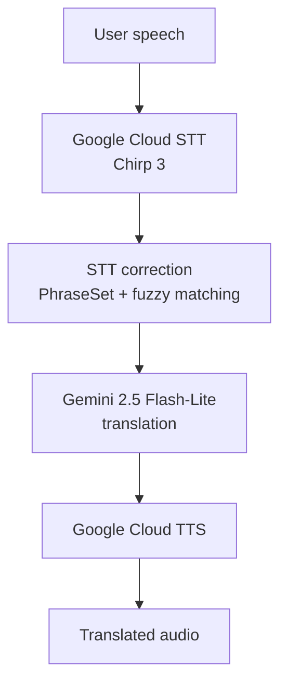
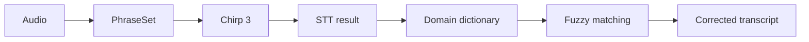

# Real-Time Interpretation Service

**Real-time speech-to-speech interpretation between counselors and customers, connecting STT, LLM translation, and TTS**

## Overview

The service recognizes speech, translates it, and plays the translation back as speech.

```
Speech → Speech-to-Text → Translation → Text-to-Speech → Translated speech
```

Because it was used in live counseling sessions, translation accuracy alone was not enough. The design had to balance:


| Quality                        | Speed                     | Environment                               |
| ------------------------------ | ------------------------- | ----------------------------------------- |
| STT accuracy                   | Translation response time | Microphone input quality                  |
| Domain terminology recognition | TTS generation time       | **End-to-end latency perceived by users** |
| Number recognition             |                           |                                           |


## My role


| Area               | Responsibilities                                                                                                                                        |
| ------------------ | ------------------------------------------------------------------------------------------------------------------------------------------------------- |
| **Speech-to-Text** | Evaluated and replaced STT/TTS engines · migrated from Google Cloud STT v1 to v2 Chirp 3 · handled streaming and utterance states                       |
| **STT accuracy**   | Applied PhraseSet-based speech adaptation · built domain dictionaries with fuzzy-matching post-correction                                               |
| **Translation**    | Implemented real-time translation with Gemini · designed domain-specific prompts for banking and hospital settings                                      |
| **Text-to-Speech** | Integrated Google Cloud TTS                                                                                                                             |
| **Audio input**    | Evaluated VAD-based automatic mic switching · implemented counselor/customer mic control logic · tested microphone devices and automated device mapping |
| **Performance**    | Reduced latency across STT, translation, and TTS                                                                                                        |


## Architecture




## Speech-to-Text


### From Web Speech API to Google Cloud

The MVP used the browser's **Web Speech API**. It was quick to implement and easy to test without extra infrastructure, but supported languages and voices varied by browser and OS, making it hard to keep the production environment consistent. I moved to **Google Cloud STT/TTS**.

### Google Cloud STT v1

v1 streaming delivered interim results quickly, so text appeared in real time while the user was still speaking. In actual counseling sessions, however, misrecognitions kept recurring for:

- numbers
- financial terms
- similar-sounding words
- proper nouns
- some multilingual utterances

To improve accuracy, I switched to **STT v2 with the** `chirp_3` **model**.

### Chirp 3

Accuracy improved with Chirp 3, but it could not always show interim results the way v1 did. Rather than forcing the old behavior, **I adapted the UI to fit the model**:

```
User speaks → "Speaking..." indicator → Final STT result
```


## STT adaptation & correction

The STT model alone could not fully resolve domain-term errors, so I added a correction step **both before and after recognition**.




### Before recognition: PhraseSet

Frequently used banking expressions were managed as **PhraseSets** in Chirp 3, for example:

```
정기예금 (time deposit) · 정기적금 (installment savings) · 금리 (interest rate)
이체 (transfer) · 자동이체 (auto-transfer) · 중도해지 (early termination) · 우대금리 (preferential rate)
```

Number-related expressions and general financial terms were kept in **separate PhraseSets**, with boost values tuned per phrase.

### After recognition: domain dictionary + fuzzy matching

Similar-sounding errors that remained after PhraseSet were corrected once more at the application level:

```
전기예금 (misrecognized)  →  정기예금 (time deposit)
```

I maintained separate dictionaries for the banking and hospital domains, and **corrections were applied only above a similarity threshold** to avoid over-correcting valid input.

## Translation

Translation used `gemini-2.5-flash-lite`.

In real-time interpretation, returning a result quickly mattered more than complex reasoning. Short sentences arrive continuously during a session, so instead of maximizing the quality of each result with a larger model, I chose to **deliver sufficient translation quality repeatedly at low latency**.

Prompts were kept short as well, since prompt length also affects response time. For banking sessions, only these rules were kept:

```text
You are a professional interpreter for a bank counseling conversation
between a bank counselor and a customer.

- Keep meaning exact and complete.
- Preserve politeness/tone appropriate for banking service.
- Keep numbers, dates, account/card/product names accurate.
- Use correct banking terminology.
- Do not add explanations or notes.

Translate from {source_language} to {target_language}.
Output only the translation.
```


## Audio input

Beyond STT accuracy, **the microphone input itself was a major problem**. In a counseling setting, one microphone could pick up:

```
Own voice + the other person's voice + TTS playback + ambient noise
```

The most serious issue was **feedback**: TTS output was picked up by the microphone and recognized as a new utterance.


| Attempt                                  | Result                                                                                                                                 |
| ---------------------------------------- | -------------------------------------------------------------------------------------------------------------------------------------- |
| VAD-based automatic mic switching        | Unstable in real sessions due to overlapping speech and state-transition delays                                                        |
| **Counselor-mic-driven channel control** | Controlled the other channel based on the counselor's mic state; combined with **unidirectional microphones** to improve input quality |


## Retrospective

Trial and error during implementation — model migration, latency, speech adaptation, fuzzy matching, VAD, and microphone selection — is documented separately:

→ [Development Retrospective](./RETROSPECTIVE.md)

## Tech stack


| Category        | Tools                                                               |
| --------------- | ------------------------------------------------------------------- |
| **Speech**      | Google Cloud Speech-to-Text · Chirp 3 · Google Cloud Text-to-Speech |
| **Translation** | Gemini 2.5 Flash-Lite                                               |
| **Backend**     | Python · Flask · REST API                                           |
| **Frontend**    | React                                                               |
| **Cloud**       | Google Cloud Platform                                               |


