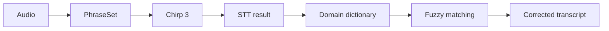

# Development Retrospective

The biggest takeaway from building this interpretation service was that **shipping features quickly and building a structure that holds up in real service are two different things.**

Early on, I relied heavily on AI coding tools like Cursor to build the prototype quickly. They were clearly effective for setting up the initial structure and connecting multiple APIs.

As development went on, though, writing code fast mattered less than answering questions like these:

- What exactly is the problem right now?
- Is the cause the model, the network, or the audio input?
- What trade-offs come with changing an API or model?
- How does it actually feel to users in a real counseling session?

> **The quality of the result depended less on how fast code was generated, and more on how precisely I defined problems, researched them, and verified changes one at a time.**

  


## 1. Working is not the same as usable

On paper, the architecture was simple:

```
Speech → STT → Translation → TTS → Translated speech
```

In practice, perceived quality was the sum of every step:

```
Audio input → Speech detection → STT → Translation → TTS generation → Playback
```

A delay at any single step made users feel the **entire service** was slow.

STT was especially critical because it was the starting point for everything after it:

- If recognition was **slow**, translation and TTS were slow too.
- If recognition was **wrong**, every later step processed the wrong sentence.

So the question I kept coming back to was not *"Which model is best?"* but:

> **"Which kind of performance should this service prioritize?"**

  


## 2. Translation model and latency

Translation also required balancing quality against speed.

At first, I wanted to put many rules into the prompt:

- preserve financial terminology
- preserve numbers
- keep a counseling tone
- no added explanations
- produce natural sentences

But in a real-time service, **prompt length is itself part of latency**. Every added rule increases the input the model must process, and that delay lands directly between STT and TTS. In the end, I kept only the rules each domain actually needed.

For the model, I used `gemini-2.5-flash-lite`. This step didn't need complex reasoning; it needed:

```
Short utterance → Fast translation → TTS
```

Since these requests repeat constantly during a session, delivering *sufficient* quality at low latency fit better than using the largest model.

> **Model selection here was not about picking the best-performing model. It was about finding the right balance of quality and speed for the service's purpose.**

  


## 3. How the speech engine evolved


| Stage | Engine                    | Strength                                                     | Problem                                                                                                         | Decision                                                       |
| ----- | ------------------------- | ------------------------------------------------------------ | --------------------------------------------------------------------------------------------------------------- | -------------------------------------------------------------- |
| **1** | Web Speech API            | Simple to implement, fast response                           | Supported languages and voices varied by browser and OS                                                         | Client dependency became a source of uncertainty in production |
| **2** | Google Cloud STT v1 / TTS | Fast interim results gave immediate "I'm listening" feedback | Repeated errors on numbers, financial terms, similar-sounding words, proper nouns, and some multilingual speech | **Prioritize accuracy over speed**                             |
| **3** | STT v2 / `chirp_3`        | Better accuracy                                              | Could not keep v1's interim-result experience                                                                   | Redesigned the UI around the model                             |


### 1. Web Speech API

In the MVP, speed of development came first. I connected STT and TTS through the browser's Web Speech API, which was simple and responsive.

Once I started thinking about production, the problem became clear: supported languages and voices depended on the browser and OS. **A client dependency that was convenient for a prototype became a source of uncertainty in production.**

### 2. Google Cloud STT v1 / TTS

Next, I moved to Google Cloud STT/TTS. The biggest advantage of v1 streaming was fast interim results: text kept appearing while the user spoke, giving immediate feedback that the system was listening.

In real counseling sessions, however, misrecognitions kept recurring for numbers, financial terms, similar-sounding words, proper nouns, and some multilingual utterances. I decided to **prioritize accuracy over speed**.

### 3. STT v2 / Chirp 3

I then switched to `chirp_3`. Accuracy improved, but the v1-style interim experience was hard to maintain, so swapping the STT model wasn't the end of it. I changed the UI behavior as well:

```
User speaks → "Speaking..." indicator → Final result
```

> **When the behavior of an AI model changes, the UX has to change with it.**

  


## 4. Chirp 3 speech adaptation

Domain-term errors remained even with Chirp 3, so I used **PhraseSets** to bias recognition toward domain expressions. The project used two:


| PhraseSet          | Contents                                                                                           | Boost                                         |
| ------------------ | -------------------------------------------------------------------------------------------------- | --------------------------------------------- |
| `number-biasing`   | Counseling expressions used with numbers: account numbers, amounts, interest rates, maturity dates | `10`                                          |
| `alphabet-biasing` | Banking product and task terms (see below)                                                         | Mostly `8`; `10` for the most important terms |


Examples from `alphabet-biasing`:

```
정기예금 (time deposit) · 정기적금 (installment savings) · 적금 (savings)
이체 (transfer) · 자동이체 (auto-transfer) · 중도해지 (early termination) · 우대금리 (preferential rate)
```

The highest-priority terms, 정기예금 and 정기적금, used boost `10`.

Higher boost makes an expression more likely to be selected, but **too much boost can produce expressions that were never actually spoken**. So rather than adding as many phrases as possible, I limited the sets to expressions that actually recur in counseling.

  


## 5. Correcting before and after recognition

The full STT correction structure:




| Stage              | When                               | Where             |
| ------------------ | ---------------------------------- | ----------------- |
| **PhraseSet**      | Before the model produces a result | Inside STT        |
| **Fuzzy matching** | After the result is returned       | Application layer |


Fuzzy matching compared results against banking and hospital domain dictionaries and corrected them only above a similarity threshold:

```
전기예금 (misrecognized)  →  정기예금 (time deposit)
```

- **Similarity threshold:** `0.75`
- **Minimum length:** words shorter than 3 characters were excluded, since short words are easily over-corrected
- **Split tokens:** cases like "정기 예금" (split into two tokens) were handled by merging adjacent tokens before comparison

  


## 6. Numbers were still hard

Numbers behave differently from ordinary words. If `8921` is recognized as `8927`, fuzzy matching can't fix it.

This project did not apply separate correction rules to digit sequences. It only biased the expressions that appear *around* numbers through the `number-biasing` PhraseSet.

As a result, domain terms like product names could be corrected fairly well, but **numbers themselves still needed dedicated validation logic**. That remains an open problem.

  


## 7. TTS came back into STT

When translated text was played back through TTS, that audio was picked up again by the microphone:

```
Speech → STT → Translation → TTS → Speaker → Microphone → STT
```

**STT wasn't wrong.** If anything, it was accurately transcribing the TTS audio from the speaker.

> **At this point, the problem was no longer the AI model. It was the structure of the audio input.**

  


## 8. VAD and microphone control

Initially, I wanted a setup where customers barely had to touch anything, so I tried switching between the two channels automatically using **VAD**.

In real sessions, though, the speaking state didn't switch reliably because of:

- overlapping speech from two people
- TTS output
- ambient noise
- network and STT event delays

In the end, I changed the design so that **the counselor controls their mic ON/OFF directly, and the customer's mic is blocked based on that state**. Accuracy went up, but so did the amount of manual control.

> **More automation does not always mean better UX.**

  


## 9. Hardware

I tested **eight candidate microphones** directly.

The one with the best audio quality had a problem: its device ID changed every time it was powered back on, so the app couldn't reliably recognize it as the same device. I switched to a different microphone and mapped device roles using **keywords in the device name**.

> **The device with the best audio quality is not necessarily the best device for real operation.**

After switching to **unidirectional microphones**, the problem of the other person's voice and ambient sound bleeding into the input also decreased.

  


## 10. What I learned


### 1. Real-time services must be judged by end-to-end latency

```
STT + Translation + TTS + Network = User-perceived latency
```

Reducing the response time of a single API doesn't solve the problem.

### 2. Prompts are part of latency

A prompt is not just configuration text; it is input the model actually processes. In a real-time service, even the number of rules involves a trade-off.

### 3. A bigger model is not always the right choice

For translation, `gemini-2.5-flash-lite` fit the service's needs better. The task called for fast, repeated translation, not complex reasoning.

### 4. STT had to be viewed as multiple layers

```
Audio quality + PhraseSet + Chirp 3 + Domain dictionary + Fuzzy matching
```

It was never something a single model swap could solve.

### 5. Changing the model changes the UX

Moving to Chirp 3 changed not just STT accuracy but how speaking state was shown on screen. **The model was not an isolated component of the system.**

  


## 11. If I did it again

Rather than choosing models first, I would **define evaluation criteria first**:


| Stage           | Criteria                                                                                             |
| --------------- | ---------------------------------------------------------------------------------------------------- |
| **STT**         | General sentence accuracy · domain term accuracy · number accuracy · interim latency · final latency |
| **Translation** | Translation latency · number preservation · domain term preservation · meaning preservation          |
| **TTS**         | Generation latency · audio quality · language support                                                |
| **Audio**       | Bleed from the other speaker · TTS feedback · background noise                                       |


Then, every time I changed a model, PhraseSet, prompt, or microphone, I would compare results **under the same conditions**.

> **The biggest lesson from this project: rather than searching for one great model, it matters more to define what each stage is responsible for, and to treat end-to-end latency and the input environment as one system.**

